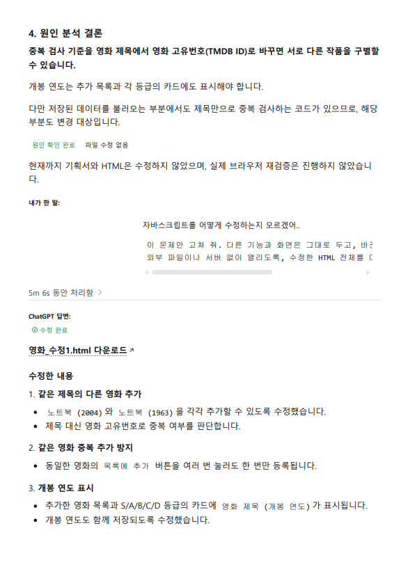
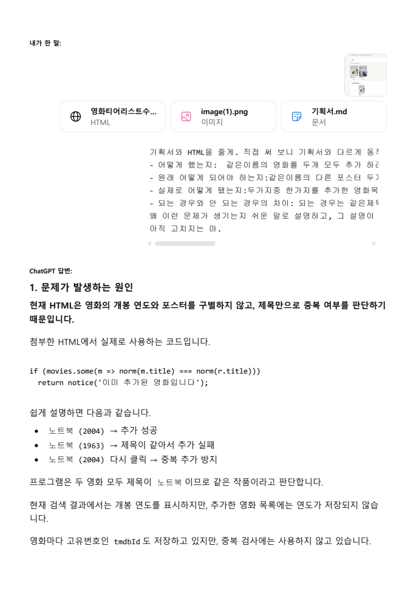
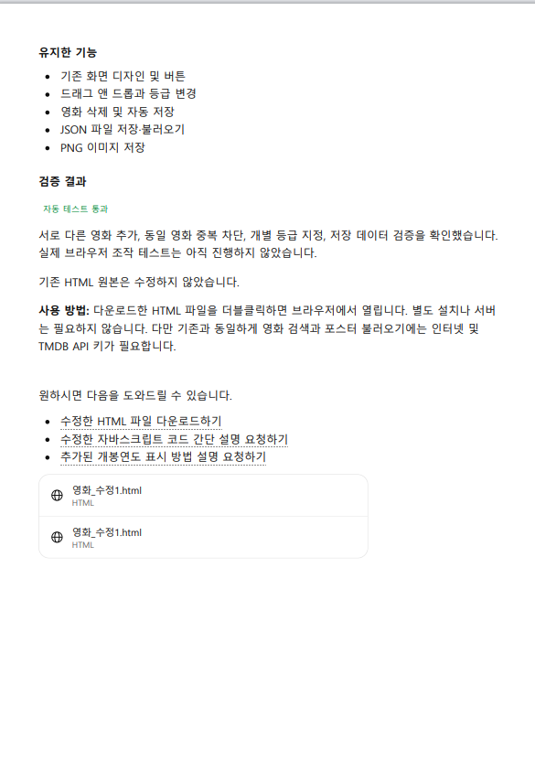
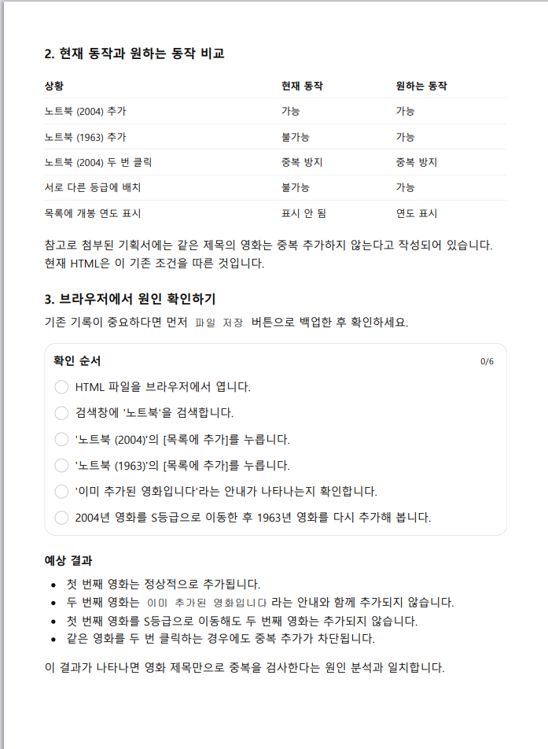

# 미션 1-2 대화내역

**주제:** 같은 제목의 서로 다른 영화가 중복으로 처리되는 오류의 원인 분석과 수정  
**사용한 AI:** ChatGPT  
**원본 대화:** [중복영화 원인 설명 - ChatGPT 공유 대화](https://chatgpt.com/share/6aec3518-7edc-83e8-b8be-1b2bada46864)

아래 이미지는 실제로 주고받은 대화를 화면 순서에 맞게 배열한 것입니다. 각각의 이미지를 클릭하면 크게 확인할 수 있습니다.

## 1. 오류를 설명하고 원인부터 질문

제목이 같은 서로 다른 영화를 추가하려 할 때 발생한 문제를 설명하고, 수정 전에 원인을 물었습니다.

## 2. 현재 동작과 원하는 동작 비교 및 확인 방법

AI가 제목 기반 중복 판정을 원인으로 설명하고, 브라우저에서 확인할 순서를 안내했습니다.

## 3. 원인 분석 후 수정 요청과 변경 내용

영화 제목이 아닌 고유번호(TM​​DB ID)로 작품을 구별하도록 요청했고, AI가 동일한 영화의 중복 추가 방지와 개봉연도 표시 등을 수정했다고 답했습니다.

## 4. 기존 기능 유지 및 수정 결과 설명

AI가 유지하려 한 기능과 자동 테스트 결과, 실제 브라우저 재검증 여부를 설명한 대화입니다.

---

## 관련 제출 파일

- [영화_수정전.html](영화_수정전.html) — 원본 파일
- [영화_수정1.html](영화_수정1.html) — 오류 수정 파일
- [미션_2_기록.md](미션_2_기록.md) — 문제 발견과 수정 기록
- [실제검증내역.md](실제검증내역.md) — 수정 전후 및 완성 기준 8개 검증 화면

**증거 범위:** 위의 네 장은 질문·답변과 수정 결과에 대한 **AI 대화 화면 증거**입니다. 이미지에 나타난 자동 테스트 통과 설명은 당시 AI의 답변이며, 이 사진만으로 실제 브라우저에서 클릭·드래그·반복 검증을 수행했음을 증명하지는 않습니다.
