# 미션 1-2 실제검증내역

2026년 11월 7일에 확인한 **같은 제목의 다른 영화 추가 오류 수정 전후**와 **기획서 완성 기준 8개 항목·초기 영화 전체 이동**을 한 문서로 모았습니다. 이 문서에는 사용자 제공 검증 사진 **11장**이 포함되며, 원본 이미지는 같은 폴더의 `자료원본/`에 보관합니다.

---

## 1. 수정 전후 오류 재현 및 비교

**검증 목적:** 제목이 같지만 개봉연도와 포스터가 다른 두 영화가 수정 전에는 중복으로 처리되고, 수정 후에는 각각 추가되는지 비교합니다.

**실행 환경:** Microsoft Edge에서 HTML 파일을 직접 열어 확인한 화면  
**테스트 영화:** `노트북 (2004)` / `노트북 (1963)`  
**비교 파일:** `영화_수정전.html` / `영화_수정1.html`

### 1. 수정 전 - 같은 제목의 다른 영화가 추가되지 않는 오류

`노트북`을 검색하면 개봉연도가 다른 두 영화가 검색되지만, 한 작품을 이미 추가한 상태에서 다른 작품의 **목록에 추가**를 누르면 `이미 추가된 영화입니다`라고 표시됩니다. 화면의 추가한 영화 목록은 **11편**입니다.

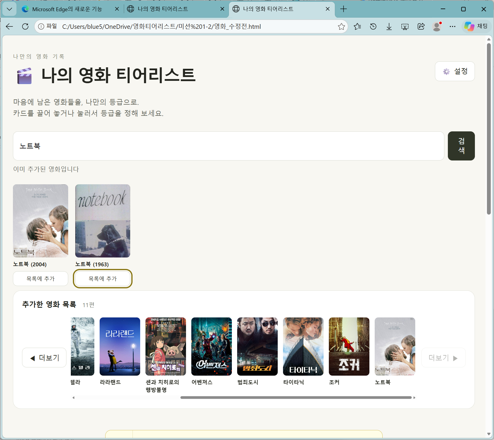

### 2. 수정 후 - 같은 제목의 다른 영화를 각각 추가

`영화_수정1.html`에서 같은 제목의 두 작품을 추가한 뒤 **`노트북 (2004)`와 `노트북 (1963)`이 모두 추가한 영화 목록에 표시**됩니다. 화면의 추가한 영화 목록은 **12편**입니다.

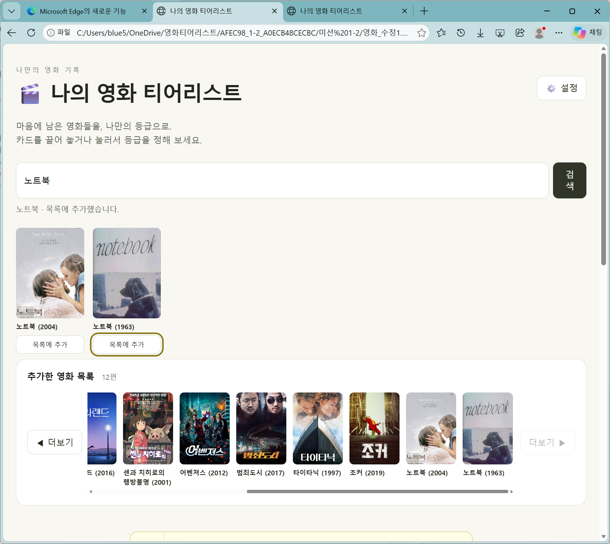

### 3. 두 화면 비교 결과

| 확인 항목 | 수정 전 화면 | 수정 후 화면 |
|---|---|---|
| 같은 제목의 다른 두 영화 검색 | 두 작품 검색됨 | 두 작품 검색됨 |
| 서로 다른 작품을 모두 목록에 추가 | `이미 추가된 영화입니다` 표시, 한 작품만 목록에 있음 | `노트북 (2004)`와 `노트북 (1963)`이 모두 목록에 있음 |
| 추가한 영화 수 | 11편 | 12편 |
| 화면에 나타난 결과 | 제목이 같다는 이유로 별개의 작품 추가가 막힘 | 두 작품을 별도로 구분해 추가한 것을 확인 |

**검증 결론:** 첨부한 실제 실행 화면 2장을 비교하면 **같은 제목의 서로 다른 영화가 추가되지 않던 문제는 수정 후 해결된 모습**을 확인할 수 있습니다.

> **증거 범위:** 이 두 화면은 수정 전·후 **영화 목록 추가 결과**를 보여 줍니다. 모든 기본 영화 이동, 클릭·드래그 등급 변경, 두 번 반복한 재현성, 파일을 닫았다 다시 연 저장 결과까지 증명하는 것은 아닙니다.

### 오류 검증 관련 자료

- [대화내역.md](대화내역.md) - 오류 원인 질문과 AI 수정 과정
- [영화_수정전.html](영화_수정전.html) - 원본
- [영화_수정1.html](영화_수정1.html) - 수정본
- [미션_2_기록.md](미션_2_기록.md) - 미션 기록

---

## 2. 기획서 완성 기준 실행 검증

- 검증일: 2026년 11월 7일
- 검증자: 김도영
- 검증 파일: `영화_수정1.html`
- 실행 환경: Windows, Microsoft Edge, 컴퓨터에 저장한 HTML 파일을 직접 열어 사용
- 비교 기준: GitHub의 `미션 1-1/기획서.md`에 적힌 완성 기준 8개
- 검증 방식: 각 기능을 브라우저에서 직접 사용하고 화면을 캡처함

> 아래의 **검증 완료** 표기는 사용자가 직접 수행했다고 확인한 결과입니다. 첨부 화면으로 확인되는 사실과, 화면 한 장만으로는 실행 과정 전체를 확인하기 어려운 부분을 구분했습니다.

### 완성 기준별 결과

| 번호 | 완성 기준 | 사용자가 확인한 결과 | 화면에서 확인 가능한 증거 |
|---|---|---|---|
| 1 | 검색한 영화의 포스터·제목 표시 및 목록 추가 | 검증 완료 | 검색 결과와 추가한 영화 목록이 보임 |
| 2 | 드래그 앤 드롭으로 S/A/B/C/D 등급 간 이동 | 검증 완료 | 영화를 각 등급에 배치한 결과가 보임 |
| 3 | 같은 브라우저에서 파일을 다시 열어도 기록 유지 | 검증 완료 | 재실행 후라고 제출한 화면에 영화와 등급이 남아 있음 |
| 4 | 등급이 정해진 티어리스트를 PNG 이미지로 저장 | 검증 완료 | 저장된 PNG 파일을 사진 뷰어에서 연 화면이 보임 |
| 5 | 파일 저장 후 불러오기 | 검증 완료 | 영화 배치와 `기록 불러오기` 선택 창이 보임. 복원 전후의 동일성은 사진 한 장으로 단정할 수 없음 |
| 6 | 별도 서버·로그인 없이 HTML 한 장으로 열기 | 검증 완료 | Edge 주소창에서 로컬 HTML 파일을 연 상태가 보임 |
| 7 | 화면 폭이 좁아져도 오른쪽이 잘리지 않기 | 검증 완료 | 좁은 브라우저 창에서도 검색창·영화 목록·등급이 보임 |
| 8 | 빈칸·공백만 입력하면 카드 생성 방지 및 안내 | 검증 완료 | `영화 제목을 입력해주세요`라는 문구가 보임 |

#### 1. 영화 검색·포스터 표시·영화 목록 추가

검색 시 포스터와 영화 제목을 확인하고, 검색 결과의 영화를 추가한 영화 목록으로 이동하는 과정을 검사했습니다.

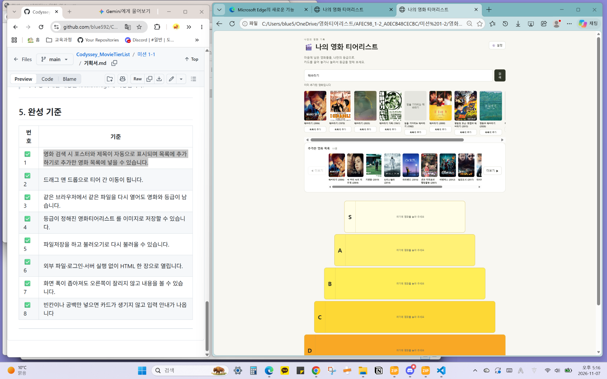

#### 2. 드래그 앤 드롭으로 등급 이동

영화를 S/A/B/C/D 등급으로 옮기는 기능을 확인했습니다. 제출한 화면에는 등급별로 여러 영화가 배치되어 있습니다.

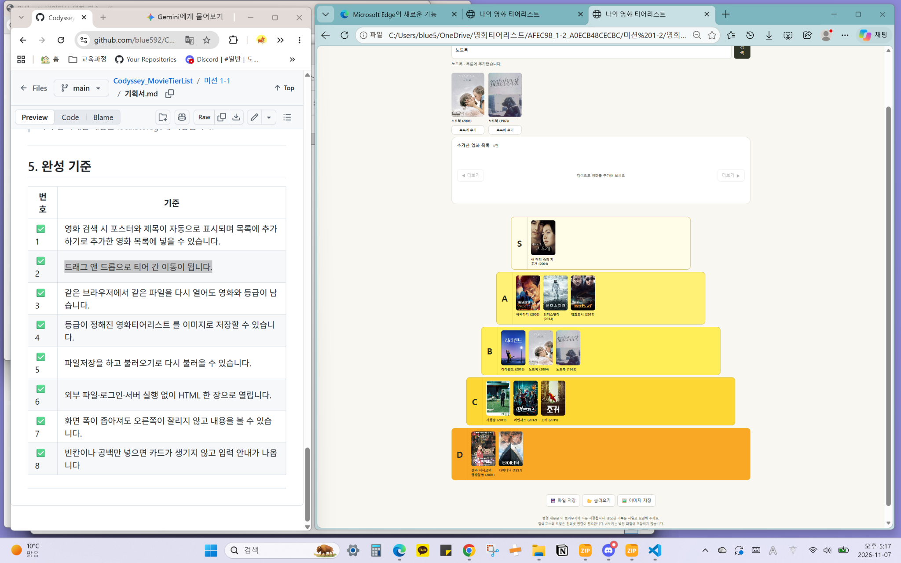

#### 3. 같은 브라우저에서 다시 열었을 때 기록 유지

사용자가 같은 파일을 다시 열고 영화 및 등급이 유지되는 것을 확인했다고 보고했습니다. 아래 화면은 다시 연 뒤의 배치를 나타내는 증거로 제출한 것입니다.

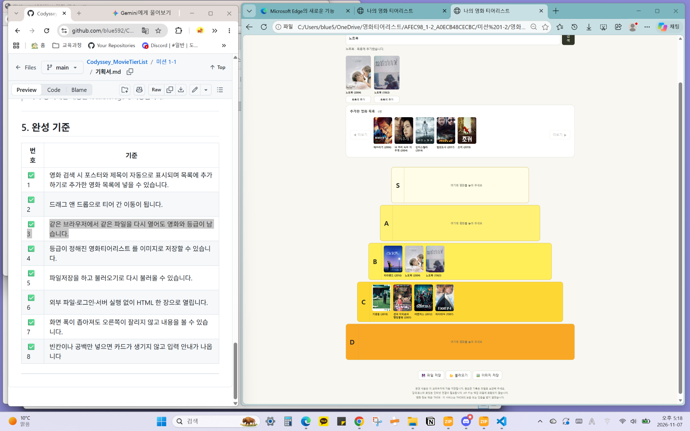

#### 4. PNG 이미지로 저장

등급이 정해진 티어리스트를 이미지로 저장했고, 저장된 `나의 영화 티어리스트.png` 파일을 이미지 뷰어에서 열어 확인했습니다.

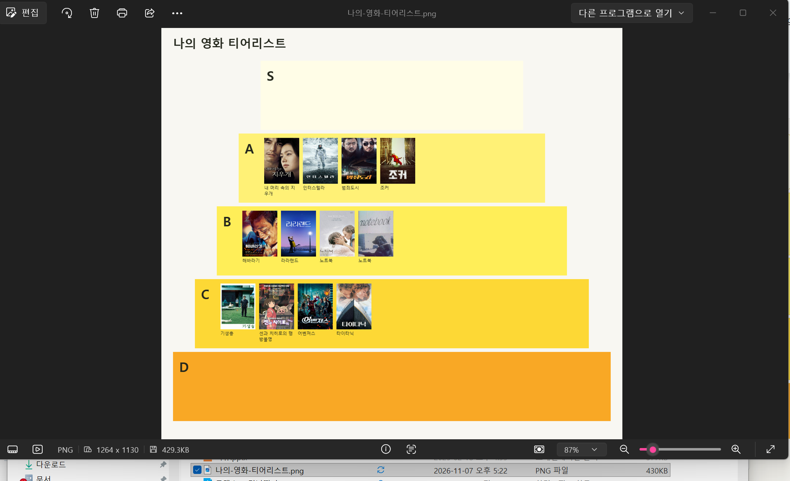

#### 5. 파일 저장 및 불러오기

사용자가 파일로 저장하고 불러오는 기능을 실행했다고 보고했습니다. 아래 사진에서 `기록 불러오기` 창과 불러오기 선택지를 확인할 수 있습니다. 데이터가 정확히 복원되었는지는 파일 전후의 추가 캡처나 JSON으로 보강할 수 있습니다.

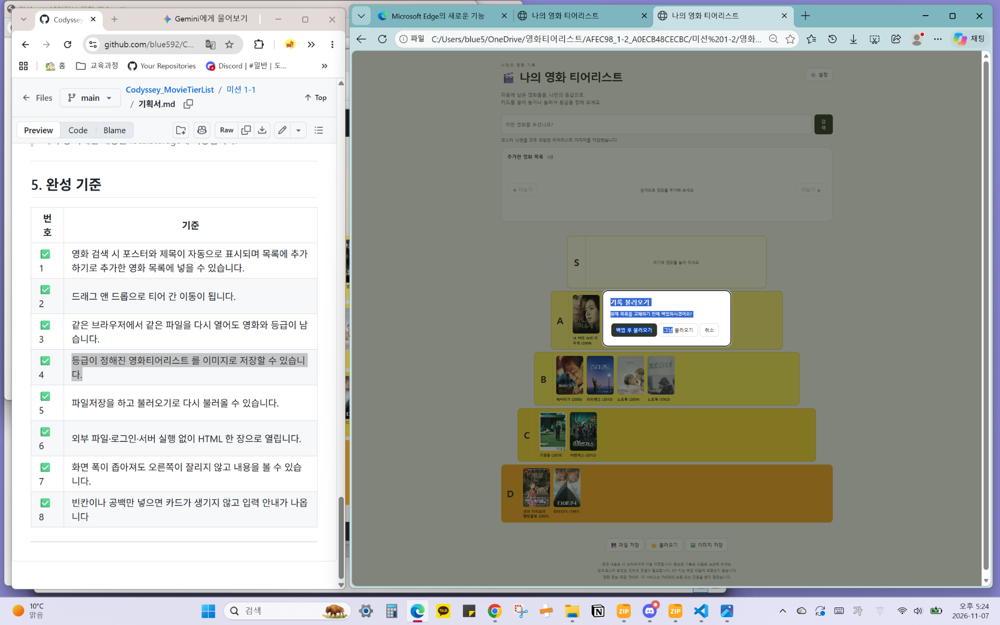

#### 6. HTML 파일 단독 실행

Microsoft Edge의 주소창에 컴퓨터에 저장된 `.html` 파일 경로가 표시됩니다. 로그인이나 로컬 서버 구동 없이 화면을 열어 확인했습니다. 다만 온라인 영화 검색 및 포스터 표시에는 인터넷 연결이 필요할 수 있습니다.

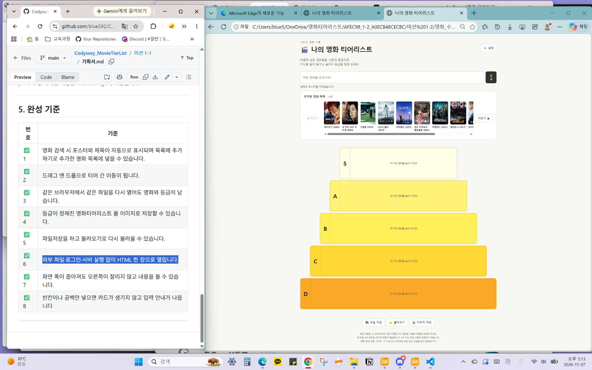

#### 7. 좁은 화면에서 표시

브라우저 창 너비를 줄여 검색창, 추가한 영화 목록, 등급 배치의 표시 상태를 확인했습니다.

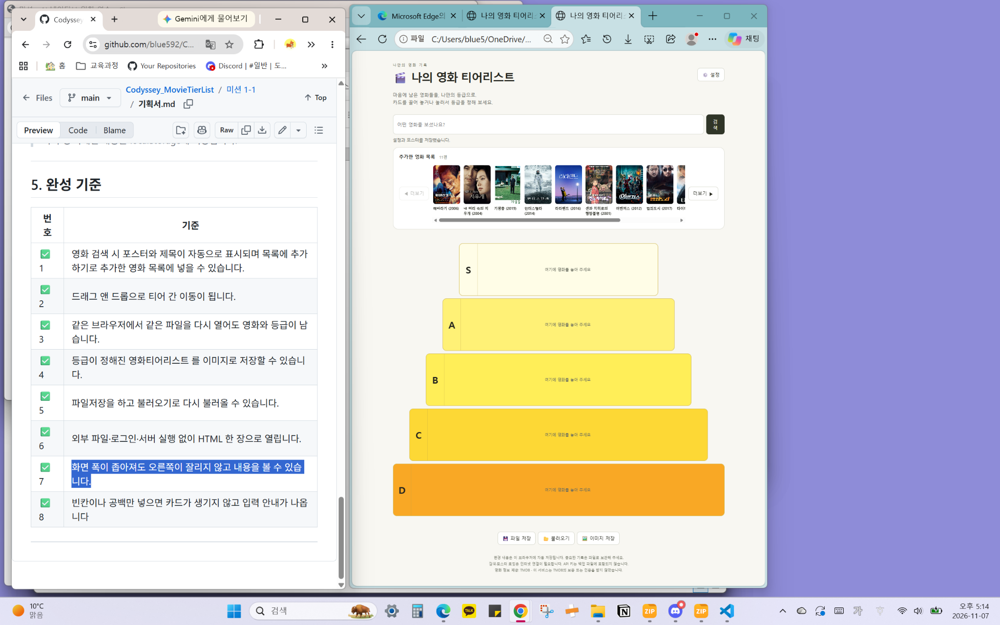

#### 8. 빈 제목 입력 방지

제목을 입력하지 않은 상태에서 검색을 시도했고, 영화 카드가 추가되는 대신 입력 안내 문구가 나타나는 것을 확인했습니다.

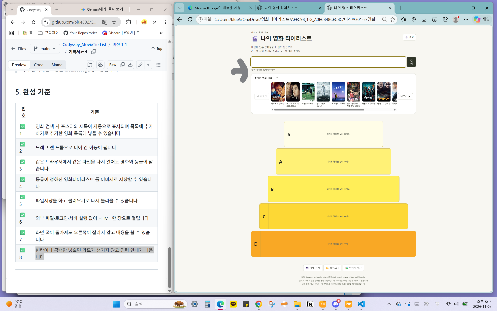

### 초기 영화 전체 이동 확인

사용자는 처음 목록에 있던 영화를 하나도 빠뜨리지 않고 모두 등급으로 옮겼다고 보고했습니다. 아래 추가 화면에는 **추가한 영화 목록 0편**과 S/A/B/C/D 등급에 배치된 **영화 10편**이 확인됩니다.

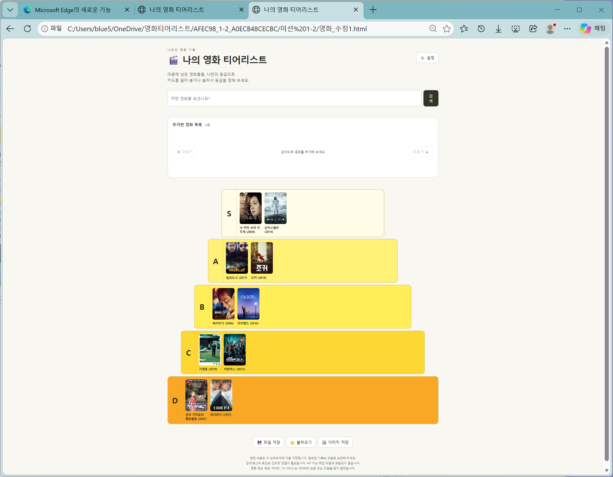

### 관련 증거 문서

- [원본 HTML: 영화_수정전.html](영화_수정전.html)
- [수정 HTML: 영화_수정1.html](영화_수정1.html)
- [AI와의 주요 대화 화면](대화내역.md)
- [문제 발견·원인·수정 기록](미션_2_기록.md)

### 검증 범위에 대한 메모

- `처음으로` 버튼은 이 티어리스트에 **처음부터 만들지 않은 기능**이라 해당 버튼을 눌러 확인한 결과는 없습니다.
- 완성 기준 8개 항목의 확인과 **미션 1-2 사전평가 12개 항목 통과**는 별개입니다. 클릭·드래그 각각의 실행 순간이나 동일 오류를 두 번 재현한 증거가 추가로 요구될 수 있습니다.
- 위 사진은 실제 사용자 제공 캡처이며, 부족한 증거를 추측하여 성공으로 작성하지 않았습니다.

---

## 이미지 보관과 열람 안내

- 이 문서에 넣은 실제 검증 화면 11장과 [대화내역.md](대화내역.md)에 넣은 대화 화면 4장을 모두 `자료원본/` 폴더 한 곳에서 관리합니다.
- GitHub에서 이 문서를 열면 사진이 본문에 표시됩니다. 사진을 클릭하면 원본 크기로 확인할 수 있습니다.
- 비교용 `영화_수정전.html`과 수정본 `영화_수정1.html`은 변경하지 않았습니다.
