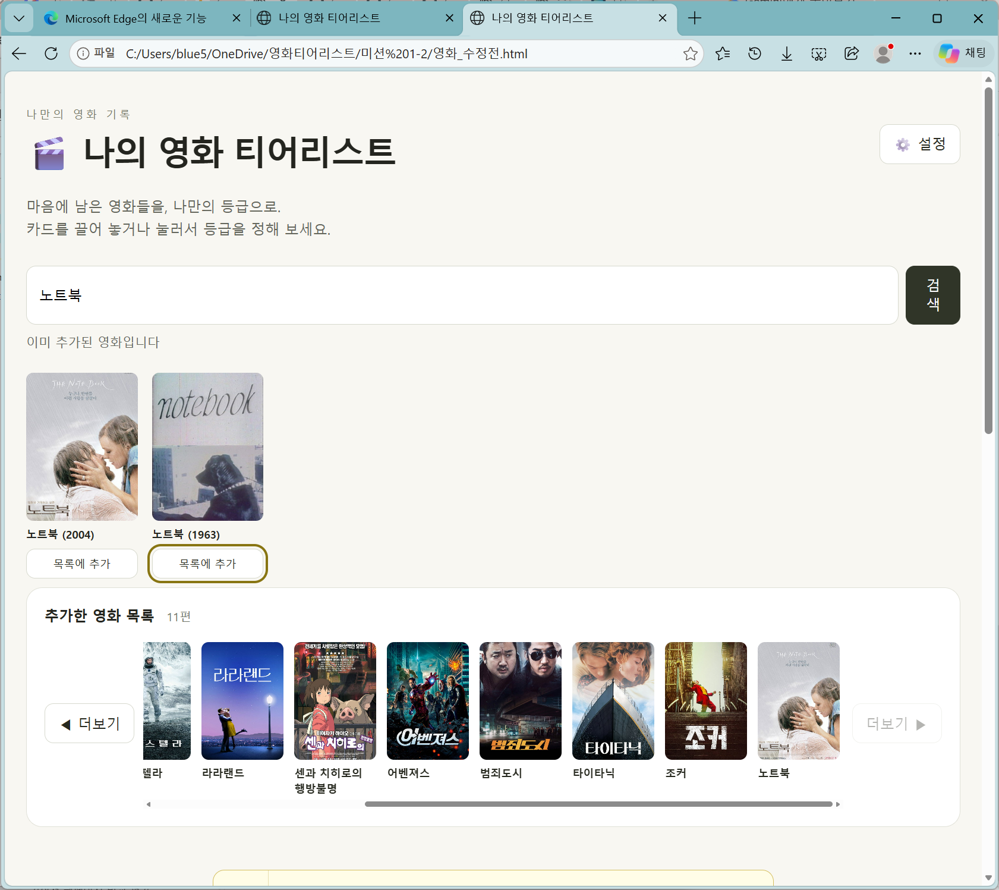
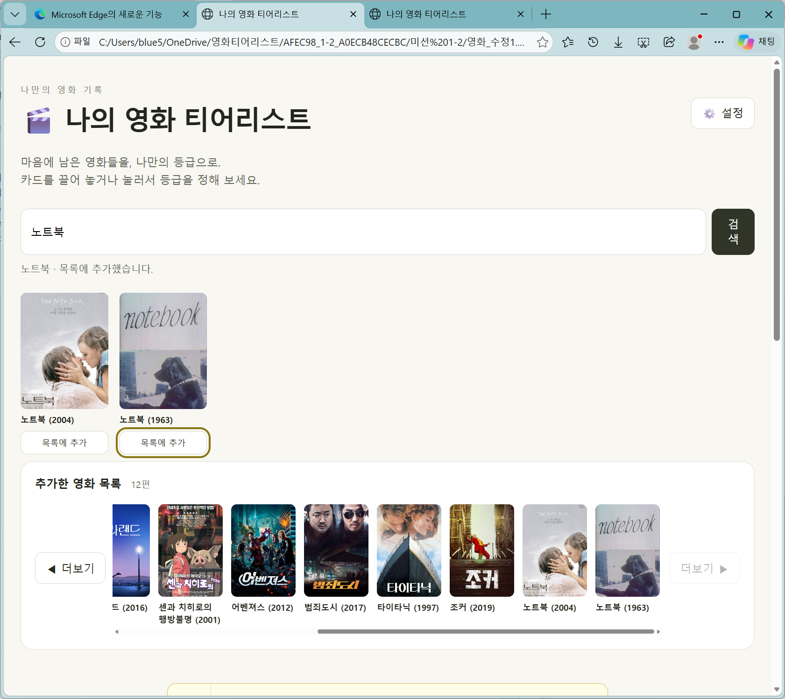

# 미션 1-2 실제 검증 스크린샷

**검증 목적:** 제목이 같지만 개봉연도와 포스터가 다른 두 영화가 수정 전에는 중복으로 처리되고, 수정 후에는 각각 추가되는지 비교합니다.

**실행 환경:** Microsoft Edge에서 HTML 파일을 직접 열어 확인한 화면  
**테스트 영화:** `노트북 (2004)` / `노트북 (1963)`  
**비교 파일:** `영화_수정전.html` / `영화_수정1.html`

## 1. 수정 전 - 같은 제목의 다른 영화가 추가되지 않는 오류

`노트북`을 검색하면 개봉연도가 다른 두 영화가 검색되지만, 한 작품을 이미 추가한 상태에서 다른 작품의 **목록에 추가**를 누르면 `이미 추가된 영화입니다`라고 표시됩니다. 화면의 추가한 영화 목록은 **11편**입니다.

## 2. 수정 후 - 같은 제목의 다른 영화를 각각 추가

`영화_수정1.html`에서 같은 제목의 두 작품을 추가한 뒤 **`노트북 (2004)`와 `노트북 (1963)`이 모두 추가한 영화 목록에 표시**됩니다. 화면의 추가한 영화 목록은 **12편**입니다.

## 3. 두 화면 비교 결과

| 확인 항목 | 수정 전 화면 | 수정 후 화면 |
|---|---|---|
| 같은 제목의 다른 두 영화 검색 | 두 작품 검색됨 | 두 작품 검색됨 |
| 서로 다른 작품을 모두 목록에 추가 | `이미 추가된 영화입니다` 표시, 한 작품만 목록에 있음 | `노트북 (2004)`와 `노트북 (1963)`이 모두 목록에 있음 |
| 추가한 영화 수 | 11편 | 12편 |
| 화면에 나타난 결과 | 제목이 같다는 이유로 별개의 작품 추가가 막힘 | 두 작품을 별도로 구분해 추가한 것을 확인 |

**검증 결론:** 첨부한 실제 실행 화면 2장을 비교하면 **같은 제목의 서로 다른 영화가 추가되지 않던 문제는 수정 후 해결된 모습**을 확인할 수 있습니다.

> **증거 범위:** 이 두 화면은 수정 전·후 **영화 목록 추가 결과**를 보여 줍니다. 모든 기본 영화 이동, 클릭·드래그 등급 변경, 두 번 반복한 재현성, 파일을 닫았다 다시 연 저장 결과까지 증명하는 것은 아닙니다.

## 관련 자료

- [대화내역.md](대화내역.md) - 오류 원인 질문과 AI 수정 과정
- [영화_수정전.html](영화_수정전.html) - 원본
- [영화_수정1.html](영화_수정1.html) - 수정본
- [미션_2_기록.md](미션_2_기록.md) - 미션 기록
