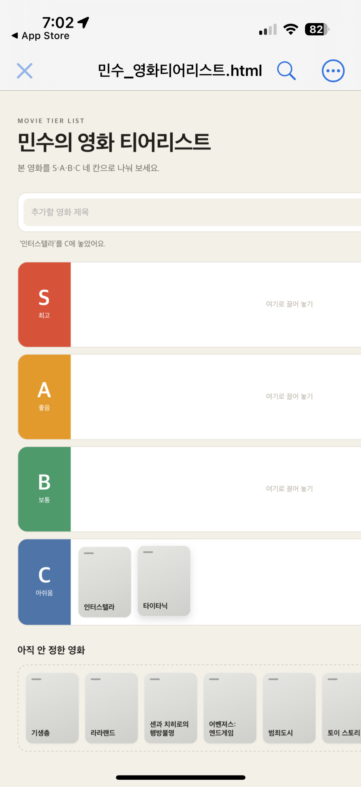

# 미션 1-3 검증 캡쳐 자료

민수 님의 기획서와 영화 티어리스트 실행 화면을 비교하면서 남긴 캡처 2장을 정리했습니다. 첨부받은 PNG 원본은 [검증캡쳐자료원본 폴더](./검증캡쳐자료원본/)에 각각 보관했습니다.

## 1. 모바일 화면에서 오른쪽이 잘리는 현상

- **확인한 행동:** 휴대폰에서 `민수_영화티어리스트.html`을 열어 S·A·B·C 등급과 아직 안 정한 영화 목록을 살펴봤습니다.
- **사진에서 확인한 결과:** 등급의 왼쪽 표시는 보이지만 입력창과 영화 목록의 오른쪽이 화면 밖으로 이어져 전체 내용을 한눈에 볼 수 없습니다.
- **기획서 기준:** ‘화면 폭이 좁아져도 오른쪽이 잘리지 않고 내용을 볼 수 있습니다.’
- **개선 제안:** 화면 너비에 따라 등급 칸과 카드의 크기·배치를 조절하고, 내용이 숨겨지지 않도록 반응형 화면을 보완하면 좋겠습니다.

## 2. 기획서와 웹 사용 화면 비교

- **확인한 행동:** 왼쪽에 기획서의 ‘화면과 동작’ 및 ‘완성 기준’을 열어 놓고, 오른쪽에 실제 HTML 화면을 띄워 비교했습니다.
- **사진에서 확인한 결과:** S·A·B·C 등급별 색상과 영화 카드 배치가 보입니다. `인터스텔라`가 S등급에, `기생충`·`라라랜드` 등이 A등급에 놓인 상태를 확인할 수 있습니다. C등급에는 같은 제목의 카드가 여러 개 있고 제목이 비어 있는 회색 카드도 보입니다.
- **관련 확인 사항:** 등급 표시와 카드 배치는 구현되어 있으나, 빈 제목 카드와 같은 제목의 중복 추가는 사용 중 불편할 수 있습니다.
- **사진만으로 확정할 수 없는 점:** 새로고침 후 저장 유지 여부와 ‘처음으로’ 버튼의 초기화 결과는 정지 화면만으로 판단할 수 없습니다. 해당 동작의 직접 확인 결과는 [미션3_기록.md](./미션3_기록.md)에 적혀 있습니다.

## 관련 기록

- [미션3_기록.md](./미션3_기록.md) — 받은 의견별 실제 확인 결과와 결정 이유
- [피드백.md](./피드백.md) — 민수 님께 보내는 장점과 개선 제안

이 문서는 캡처에 보이는 사실과 다른 동작을 직접 실행해야 알 수 있는 사실을 구분해 기록합니다. 원본 HTML과 기존 미션 기록의 내용은 수정하지 않았습니다.
